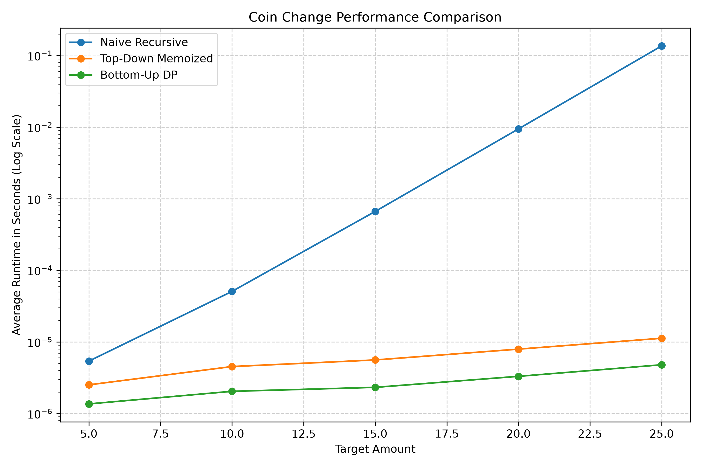

# Empirical Comparison

I compared the naive recursive, top-down memoized, and bottom-up dynamic programming approaches using the coin denominations `[1, 2, 5]` and target amounts of 5, 10, 15, 20, and 25. Each algorithm was run three times for each amount and the average runtime was recorded. All three approaches returned the same answers, but their runtimes became very different as the target amount increased.

| Amount | Recursive (s) | Memoized (s) | Bottom-Up DP (s) |
|---:|---:|---:|---:|
| 5 | 0.000005389 | 0.000002514 | 0.000001361 |
| 10 | 0.000050792 | 0.000004528 | 0.000002042 |
| 15 | 0.000665153 | 0.000005597 | 0.000002320 |
| 20 | 0.009443792 | 0.000007930 | 0.000003306 |
| 25 | 0.136331403 | 0.000011250 | 0.000004792 |

The results show that the naive recursive approach becomes much slower as the amount increases because it repeatedly solves the same subproblems. The memoized approach improves this by saving solutions that were already calculated, while the bottom-up approach directly builds its solutions from smaller amounts. At amount 25, the recursive approach took about 0.136 seconds compared with only about 0.000011 seconds for memoization and 0.000005 seconds for bottom-up DP. This demonstrates why dynamic programming is much more efficient for this problem.
